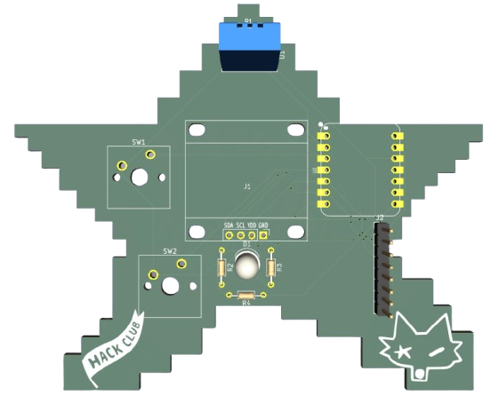
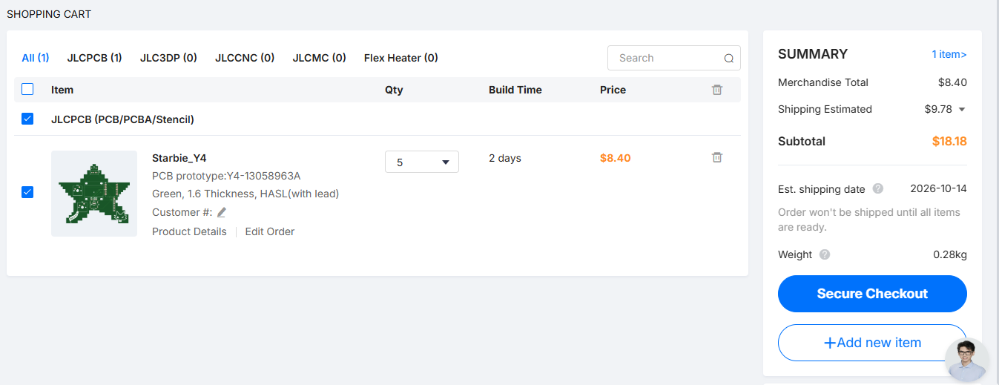

# Starbie

**A tiny motion-controlled digital pet, basically a desktop Tamagotchi. Totally not a Starboy.**

---

## What exactly is it?

Starbie is a small interactive device built around the XIAO ESP32-C3. It uses a bunch of sensors and other components to make it actually do stuff.

Some of the things packed into it:

- Movement detection using the MPU6050.
- Temperature and humidity readings using the DHT11.
- An OLED display to show information.
- An RGB LED for visual feedback.
- Cherry MX switches for physical input.

## Why I built it

I made Starbie for [HalfLife](https://halflife.hackclub.com), following their Week 1 PCB design tutorial.

Since this is my second hardware project, I wanted to build something a bit more interesting than my first one. Starbie is a tiny motion-controlled digital pet, basically a desktop Tamagotchi (totally not a Starboy).

And yeah, I'm also trying to get that 3D printer prize lol. HalfLife gives me a reason to actually design, build and document my projects instead of leaving them as ideas.

## The Schematic

The schematic was made in KiCad and shows how all the components are connected to the XIAO ESP32-C3.

## The PCB Design

I designed the board using KiCad, with a custom shape and footprints for the components.

  
   
  <i>A look at the raw KiCad layout.</i>

## Fabrication

Here's the final manufacturing quote and preview from JLCPCB before it becomes reality:

    

## Firmware

The firmware is written for the XIAO ESP32-C3 and handles Starbie's sensors, display, RGB LED and buttons. It reads movement data from the MPU6050 and temperature and humidity from the DHT11, with the OLED used to display information.

## Bill Of Materials

| Item | Qty | Supplier | Cost/item | Total Cost | Link |
|---|---:|---|---:|---:|---|
| XIAO ESP32-C3 | 1 | hubtronics | $7.17 | $7.17 | https://hubtronics.in/seeed-studio-xiao-esp32c3 |
| MPU-6050 GY-521 | 1 | hubtronics | $2.00 | $2.00 | https://hubtronics.in/gy-521-mpu-6050-gyro-accelerometer-module |
| 5mm RGB LED, 4-leg (pack of 5) | 1 | hubtronics | $0.32 | $0.32 | https://hubtronics.in/5mm-rgb-led-4-legs |
| 0.96-inch I2C OLED, white | 1 | hubtronics | $1.78 | $1.78 | https://hubtronics.in/0.96inch-i2c-4pin-oled-module-white |
| Blank translucent Cherry 1u keycaps (pack of 5) | 1 | meckeys | $1.36 | $1.36 | https://meckeys.com/shop/accessories/keyboard-accessories/keycaps/blank/blank-ch |
| Gateron Milky Pro Yellow 5-pin switches (pack of 10) | 1 | meckeys | $2.10 | $2.10 | https://meckeys.com/shop/accessories/keyboard-accessories/key-switches/gateron-mechanical-pro-switch-5pin/?attribute_pa_switch-variation=pro-milky-yellow |
| 330Ω, 1/8W resistor (pack of 42) | 1 | robu | $0.11 | $0.11 | https://robu.in/product/330-ohm-1-8w-through-hole-resistor-pack-of-5000/ |
| 10kΩ, 0.25W resistor (pack of 30) | 1 | robu | $0.11 | $0.11 | https://robu.in/product/10k-ohm-0-25w-metal-film-resistor-pack-of-100/ |
| DHT11 temperature and humidity sensor | 1 | robu | $1.57 | $1.57 | https://robu.in/product/dht-11-digital-temperature-and-humidity-sensor/ |
| Custom Starbie PCB | 1 | JLCPCB | $8.40 | $8.40 | https://jlcpcb.com/ |
| Estimated total shipping | 1 | — | — | $12.70 | — |

---
