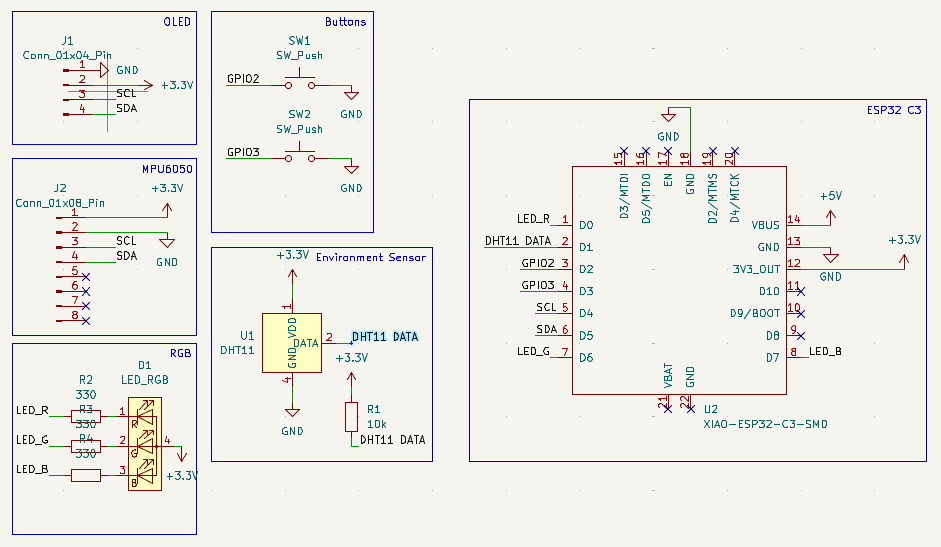
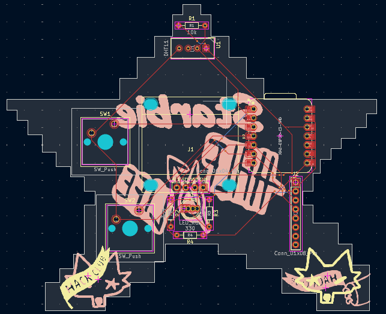

# Starbie

**A tiny motion-controlled digital pet, basically a desktop Tamagotchi. Totally not a Starboy.**

---

## What exactly is it?

Starbie is a small interactive device built around the XIAO ESP32-C3. It uses a bunch of sensors and other components to make it actually do stuff.

Some of the things packed into it:

- Movement detection using the MPU6050.
- Temperature and humidity readings using the DHT11.
- An OLED display to show information.
- An RGB LED for visual feedback.
- Cherry MX switches for physical input.

## Why I built it

I made Starbie for [HalfLife](https://halflife.hackclub.com), following their Week 1 PCB design tutorial.

Since this is my second hardware project, I wanted to build something a bit more interesting than my first one. Starbie is a tiny motion-controlled digital pet, basically a desktop Tamagotchi (totally not a Starboy).

And yeah, I'm also trying to get that 3D printer prize lol. HalfLife gives me a reason to actually design, build and document my projects instead of leaving them as ideas.

## The Schematic

The schematic was made in KiCad and shows how all the components are connected to the XIAO ESP32-C3.

## The PCB Design

I designed the board using KiCad, with a custom shape and footprints for the components.

  
   
  <i>A look at the raw KiCad layout.</i>

## Fabrication

Here's the final manufacturing quote and preview from JLCPCB before it becomes reality:

    

## Firmware

The firmware is written for the XIAO ESP32-C3 and handles Starbie's sensors, display, RGB LED and buttons. It reads movement data from the MPU6050 and temperature and humidity from the DHT11, with the OLED used to display information.

## Bill Of Materials

---

Still a work in progress.