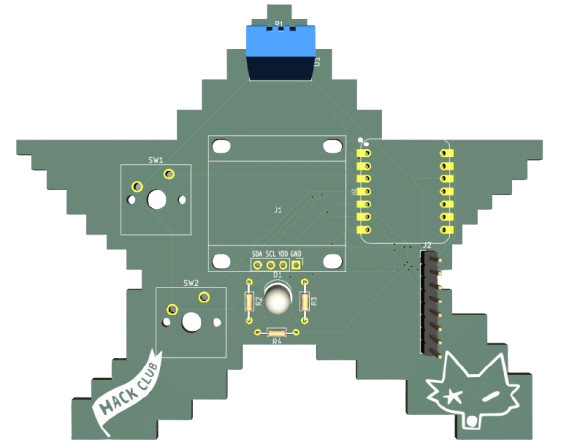
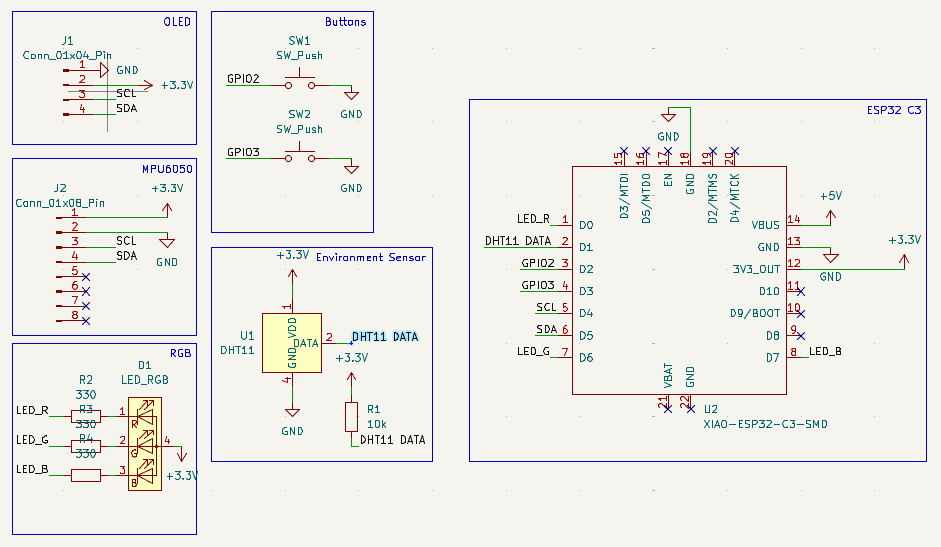
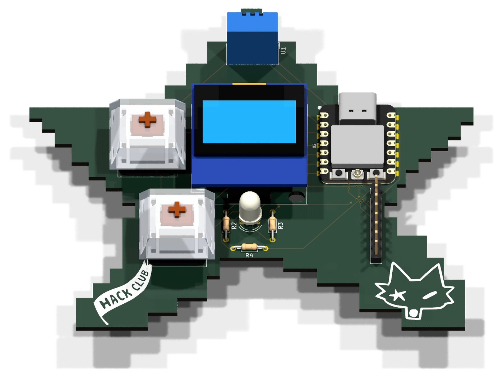
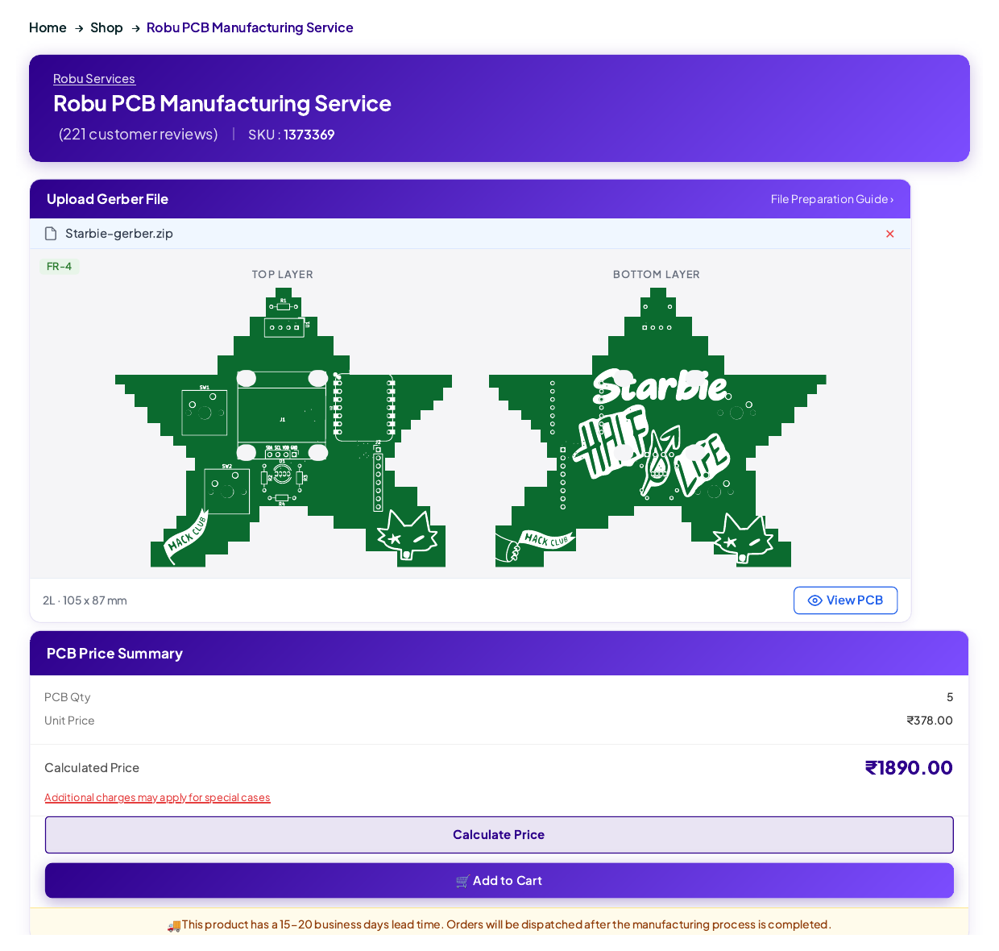

<div align="center">

# Starbie

**A tiny motion-controlled digital pet, basically a desktop Tamagotchi. Totally not a Starboy.**

A star-shaped PCB pet you tilt, shake and feed, with an OLED face, a mood LED and two clicky switches.




</div>

---

**Status:** Shipped

## What is it?

Starbie is a small interactive device built around the XIAO ESP32-C3. It uses a bunch of sensors and other components to make it actually do stuff.

Some of the things packed into it:

- **Movement detection** using the MPU6050, so you steer the menu by tilting and play by shaking
- **Temperature and humidity** readings from the DHT11
- **An OLED display** for the pet, the menu and the stats
- **An RGB LED** that shows the pet's mood
- **Two mechanical switches** (Gateron Milky Pro Yellow with Cherry-style keycaps) for input
- **Stats saved to flash**, so your pet remembers you after a reset

## Why I Built It

I made Starbie for [HalfLife](https://halflife.hackclub.com), following their Week 1 PCB design tutorial.

Since this is my second hardware project, I wanted to build something a bit more interesting than my first one. Starbie is a tiny motion-controlled digital pet, basically a desktop Tamagotchi (totally not a Starboy).

And yeah, I'm also trying to get that 3D printer prize lol. HalfLife gives me a reason to actually design, build and document my projects instead of leaving them as ideas.

The full build log is in [JOURNAL.md](JOURNAL.md).

## The Schematic

The schematic was made in KiCad and shows how all the components are connected to the XIAO ESP32-C3.

<div align="center">

</div>

## The PCB Design

I designed the board using KiCad, with a custom shape and footprints for the components.

<div align="center">
  
  <br/>
  <i>A look at the raw KiCad layout.</i>
</div>

## Fabrication

Here's the final manufacturing quote and preview from Robu before it becomes reality:

<div align="center">
    
</div>

## Firmware

The firmware is written for the XIAO ESP32-C3 and handles Starbie's sensors, display, RGB LED and buttons. It reads movement data from the MPU6050 and temperature and humidity from the DHT11, with the OLED used to display information.

### Wiring (pins)

| Part | XIAO pin | ESP32-C3 GPIO |
|---|---|---|
| OLED + MPU6050 SDA | D5 | 7 |
| OLED + MPU6050 SCL | D4 | 6 |
| DHT11 data | D1 | 3 |
| Button 1 | D2 | 4 |
| Button 2 | D3 | 5 |
| LED red | D0 | 2 |
| LED green | D6 | 21 |
| LED blue | D7 | 20 |

The RGB LED is common anode (tied to 3.3V), so the firmware drives a colour LOW to turn it on. The OLED is expected at I2C address `0x3C` and the MPU6050 at `0x68`.

### Controls

Starbie has two buttons.

| Button | Pin | What it does |
|---|---|---|
| Button 1 (SW1) | GPIO4 (XIAO D2) | Opens the radial menu. While the menu is open, it confirms the highlighted action. |
| Button 2 (SW2) | GPIO5 (XIAO D3) | Shows or hides the stats screen. It never changes the pet. |

Both buttons are debounced in software (30 ms).

### Tilt menu

1. Press **Button 1** to open the menu. The way you are holding Starbie at that moment becomes the centre.
2. Tilt Starbie. The MPU6050 accelerometer moves a ball around the screen. The screen is split into four sectors by two diagonal lines: **NAP** (top), **PLAY** (right), **FEED** (bottom) and **PET** (left).
3. The sector in the direction you tilt is highlighted. A small dead zone in the middle means nothing is highlighted until you tilt past it.
4. Press **Button 1** again to confirm. If nothing is highlighted, nothing happens and the menu stays open.
5. Pressing **Button 2** while the menu is open leaves the menu without choosing anything and shows the stats screen instead.

Which physical tilt direction moves the ball to which sector depends on how the MPU6050 is mounted. If the ball moves the wrong way, change `SWAP_MPU_AXES`, `MENU_X_DIRECTION` or `MENU_Y_DIRECTION` at the top of `Starbie.ino`.

Each action changes the pet's three stats (each stays between 0 and 100):

| Action | Joy | Energy | Fullness | What you see |
|---|---|---|---|---|
| NAP | +1 | +18 | −4 | Starbie stops and sleeps with floating Zs for 48 seconds |
| PLAY | +12 | −9 | −5 | Two fast laps across the screen with hearts |
| FEED | +3 | +2 | +18 | A small wiggle, then a jump |
| PET | +7 | 0 | 0 | A small wiggle, a jump, and hearts |

**Shake:** on the pet screen, shaking Starbie gives +5 joy, −2 energy and −1 fullness, wakes a sleeping pet, and has a 0.65 second cooldown. Shaking does nothing while the menu or stats screen is open.

Stats are saved to flash after every action and every shake, so Starbie remembers them after a reset. Stats do not drain over time; they only change when you use the menu or shake Starbie.

### Status LED

The RGB LED shows Starbie's mood. The firmware checks the stats in this order and shows the first one that matches:

| Colour | Condition | Meaning |
|---|---|---|
| Yellow | Fullness is 25 or below | Hungry |
| Blue | Energy is 25 or below | Tired |
| Red | Joy is 25 or below | Needs play |
| Green | None of the above (all three stats are above 25) | Happy |

If more than one stat is low, the first row that matches wins (yellow, then blue, then red). The LED is on/off only (no dimming or colour mixing), and yellow is red and green on together.

### Stats screen

Press **Button 2** to see Starbie's JOY, ENERGY and FULL bars with their numbers, plus the room temperature (°C) and humidity (%) from the DHT11. If the DHT11 has not produced a reading yet, the screen shows `--`. The temperature and humidity are display-only; they do not affect the pet or the LED.

## Getting Started

The firmware is one file, `Starbie.ino`.

1. Open `Starbie.ino` in the [Arduino IDE](https://www.arduino.cc/en/software) with ESP32 board support installed, and pick the **Seeed XIAO ESP32-C3** board.
2. Install these libraries from **Sketch > Include Library > Manage Libraries** (click **Install All** when it asks about dependencies):
   - Adafruit GFX Library
   - Adafruit SSD1306
   - Adafruit MPU6050
   - DHT sensor library
3. Change anything you want in the **BEGINNER SETTINGS** section at the top (pins, starting stats, tilt directions, the pet sprite).
4. Upload.

Want a fresh pet? Set `RESET_SAVED_PET_ON_BOOT` to `true`, upload once, then set it back to `false`.

## Bill Of Materials

Also in [BOM.csv](BOM.csv).

| Item | Qty | Supplier | Cost/item | Total Cost | Link |
|---|---:|---|---:|---:|---|
| XIAO ESP32-C3 | 1 | hubtronics | $7.17 | $7.17 | https://hubtronics.in/seeed-studio-xiao-esp32c3 |
| MPU-6050 GY-521 | 1 | hubtronics | $2.00 | $2.00 | https://hubtronics.in/gy-521-mpu-6050-gyro-accelerometer-module |
| 5mm RGB LED, 4-leg (pack of 5) | 1 | hubtronics | $0.32 | $0.32 | https://hubtronics.in/5mm-rgb-led-4-legs |
| 0.96-inch I2C OLED, white | 1 | hubtronics | $1.78 | $1.78 | https://hubtronics.in/0.96inch-i2c-4pin-oled-module-white |
| Blank translucent Cherry 1u keycaps (pack of 5) | 1 | meckeys | $1.36 | $1.36 | https://meckeys.com/shop/accessories/keyboard-accessories/keycaps/blank/blank-ch |
| Gateron Milky Pro Yellow 5-pin switches (pack of 10) | 1 | meckeys | $2.10 | $2.10 | https://meckeys.com/shop/accessories/keyboard-accessories/key-switches/gateron-mechanical-pro-switch-5pin/?attribute_pa_switch-variation=pro-milky-yellow |
| 330Ω, 1/8W resistor (pack of 42) | 1 | robu | $0.11 | $0.11 | https://robu.in/product/330-ohm-1-8w-through-hole-resistor-pack-of-5000/ |
| 10kΩ, 1/8W resistor (pack of 30) | 1 | robu | $0.11 | $0.11 | https://robu.in/product/10k-ohm-0-25w-metal-film-resistor-pack-of-100/ |
| DHT11 temperature and humidity sensor | 1 | robu | $1.57 | $1.57 | https://robu.in/product/dht-11-digital-temperature-and-humidity-sensor/ |
| Custom Starbie PCB | 1 | robu | $20.05 | $20.05 | https://robu.in/ |
| Total shipping | 1 | — | — | $2.38 | — |

## Tech Stack

- **KiCad** - schematic and PCB design
- **Robu** - PCB fabrication quote and preview
- **Arduino (C++)** - the firmware
- **Seeed XIAO ESP32-C3** - the brain
- **Adafruit GFX / SSD1306 / MPU6050 + DHT sensor library** - display and sensor drivers
- **Preferences (ESP32)** - saving the pet's stats to flash

## Project Structure

```
Starbie/
├── Starbie.ino       # the whole firmware, one file
├── pcb/              # KiCad project, schematic and PCB
├── output files/     # fabrication outputs (Starbie.zip)
├── assets/           # README images
├── BOM.csv           # bill of materials
└── JOURNAL.md        # devlog, synced from HalfLife
```

## What I Learned

From the journal:

- Importing custom symbols and footprints into KiCad, and assigning footprints to symbols
- Getting the schematic into the PCB editor (through the project manager) and fixing DRC errors like overlapping edge cuts
- Using vias to route on both layers instead of cramming everything onto the front copper
- Sourcing a BOM across multiple suppliers when no single shop has everything
- Swapping a part for one that's actually on the market and updating the PCB to match

## License

This project is licensed under the [MIT License](LICENSE). You're free to use, modify, and share it, as long as the original copyright notice is kept.
